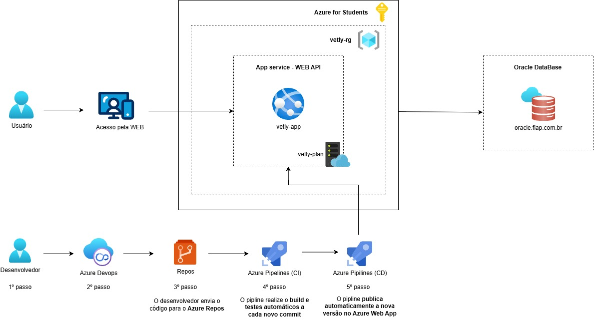

# 🐾 Vetly

> Projeto acadêmico desenvolvido para fins educacionais.

## Integrantes

| Nome | RM |
|---|---|
| 👩‍💻 Anna Clara Russo Luca | RM561928 |
| 👨‍💻 Gabriel Duarte Maciel | RM565754 |
| 👨‍💻 Gustavo Tavares da Silva | RM562827 |
| 👨‍💻 Tiago Guedes da Costa | RM564731 |

---

# 📑 Sumário

- [📌 Descrição do Projeto](#-descrição-do-projeto)
- [🏗 Arquitetura da Solução](#-arquitetura-da-solução)
- [🚀 Tecnologias Utilizadas](#-tecnologias-utilizadas)
- [💼 Benefícios para o Negócio](#-benefícios-para-o-negócio)
- [🧩 CRUD Implementado](#-crud-implementado)
- [☁️ Como Fazer o Deploy em Cloud (Azure)](#️-como-fazer-o-deploy-em-cloud-azure)
- [🛠️ Tecnologias e Serviços Utilizados](#️-tecnologias-e-serviços-utilizados)
- [🧩 Componentes da Arquitetura Cloud](#-componentes-da-arquitetura-cloud)
- [⚙️ Estrutura do Deploy e Automação (CI/CD)](#️-estrutura-do-deploy-e-automação-cicd)
- [🔗 Projeto no Azure DevOps](#-projeto-no-azure-devops)
- [📝 Funcionalidades Disponíveis na Nuvem](#-funcionalidades-disponíveis-na-nuvem)
- [📊 Benefícios da Arquitetura em Cloud](#-benefícios-da-arquitetura-em-cloud)
- [▶ Demonstração](#-demonstração)

---

# 📌 Descrição do Projeto

O **Vetly** é uma plataforma que conecta tutores de animais a veterinários independentes.

Este repositório contém a aplicação web da plataforma. O foco da entrega é o **painel administrativo (back-office)**, operado pelo perfil **ADMIN**, que cobre o núcleo clínico da operação: cadastro de tutores, veterinários e animais, agendamento e acompanhamento de consultas, prontuário eletrônico versionado e solicitação/liberação de resultados de exames.

A aplicação também possui áreas próprias para tutores e veterinários:

| Perfil | Acesso | O que faz |
|---|---|---|
| `ADMIN` | `/mvc/` | Gerencia os cadastros, as consultas, os prontuários e os exames no painel administrativo. |
| `TUTOR` | `/mvc/area-tutor` | Gerencia seus animais e consultas, acompanha prontuários e vê resultados de exames liberados. |
| `VETERINARIO` | `/mvc/area-veterinario` | Atende suas consultas, registra evoluções clínicas, gerencia prontuários e libera resultados de exames. |

Tutores e veterinários criam a própria conta pelo cadastro público em `/mvc/cadastro`. O administrador inicial é criado automaticamente na inicialização da aplicação, a partir das variáveis de ambiente.

A solução foi desenvolvida utilizando **Java 21 com Spring Boot**, arquitetura MVC e Thymeleaf, banco de dados **Oracle Database em nuvem**, disponibilizado pela FIAP, e infraestrutura de aplicação hospedada na **Microsoft Azure**, por meio do Azure App Service.

O processo de integração e entrega contínua é realizado com **Azure DevOps**, utilizando Azure Repos e Azure Pipelines para automatizar a compilação, execução dos testes, publicação do artefato e implantação da aplicação.

O projeto demonstra a aplicação prática dos conceitos de:

- Cloud Computing (PaaS).
- Infraestrutura em nuvem.
- Persistência de dados em banco relacional na nuvem.
- Integração contínua (CI).
- Entrega contínua (CD).
- Automatização de build, testes e deploy.
- Gerenciamento seguro de variáveis de ambiente.

---

# 🏗 Arquitetura da Solução



**Fluxo de acesso à aplicação:**

1. O usuário acessa o Vetly pela web, com o perfil ADMIN, TUTOR ou VETERINARIO.
2. A requisição chega ao **Azure App Service**, responsável por hospedar a aplicação Java.
3. O App Service executa a aplicação `vetly-app`, utilizando os recursos do plano `vetly-plan`.
4. A aplicação realiza a comunicação com o **Oracle Database da FIAP**, por meio de conexão JDBC.
5. Os dados são armazenados e consultados no banco Oracle, que funciona como camada de persistência da solução.

**Fluxo de desenvolvimento e implantação:**

1. O desenvolvedor realiza alterações no código e envia as atualizações para o repositório.
2. O código é disponibilizado no Azure Repos.
3. O Azure Pipelines executa o processo de CI, realizando o build e os testes automatizados.
4. Após a aprovação do CI, o pipeline publica o artefato JAR executável.
5. O estágio de CD utiliza o artefato publicado para atualizar automaticamente a aplicação no Azure App Service.

**Componentes da arquitetura:**

| Componente | Responsabilidade |
|---|---|
| Usuário | Acessa a aplicação pela web, de acordo com o seu perfil. |
| Azure DevOps | Gerencia o repositório e os pipelines. |
| Azure Repos | Armazena o código-fonte do projeto. |
| Azure Pipelines (CI) | Executa build e testes automatizados. |
| Artefato JAR | Pacote executável gerado pelo processo de build. |
| Azure Pipelines (CD) | Realiza a implantação automática da aplicação. |
| Azure App Service | Hospeda a aplicação Java. |
| App Service Plan | Fornece os recursos de hospedagem da aplicação. |
| Oracle Database FIAP | Armazena os dados da aplicação. |

---

# 🚀 Tecnologias Utilizadas

## Back-end

- Java 21
- Spring Boot 4.0.6
- Spring Security
- Spring Data JPA / Hibernate
- Thymeleaf
- Gradle
- Flyway

## Banco de Dados

- Oracle Database (instância em nuvem da FIAP).
- SQL e PL/SQL.
- Procedures, packages e triggers.
- Migrations para controle de evolução do banco de dados.

## Cloud e DevOps

- Microsoft Azure.
- Azure App Service (Linux).
- Azure App Service Plan.
- Azure Resource Group.
- Azure DevOps.
- Azure Repos.
- Azure Pipelines.
- CI/CD automatizado.
- Azure CLI para provisionamento da infraestrutura.

---

# 💼 Benefícios para o Negócio

### Centralização da operação

A equipe administrativa cadastra e gerencia tutores, veterinários e animais em um único painel, sem depender de acesso direto ao banco de dados.

### Rastreabilidade clínica

O prontuário nunca é sobrescrito: toda correção gera uma nova versão vinculada à original, com data, hora e responsável, reduzindo riscos e melhorando a auditoria do histórico clínico.

### Governança de resultados de exames

O resultado de um exame só fica visível ao tutor após liberação explícita, evitando que um laudo ainda em análise chegue prematuramente ao cliente final.

### Persistência em nuvem

Os dados permanecem armazenados no Oracle Database da FIAP, independentemente do ciclo de vida da aplicação no Azure App Service.

### Automatização do processo de entrega

A utilização do Azure DevOps permite automatizar a compilação, os testes e a publicação da aplicação, reduzindo etapas manuais e facilitando a disponibilização de novas versões.

### Segurança das configurações

As credenciais do banco de dados e demais informações sensíveis são configuradas por variáveis de ambiente, evitando sua exposição diretamente no código-fonte.
---

# 🧩 CRUD Implementado

O CRUD completo do projeto foi implementado na entidade **Consulta**, em `ConsultaMvcController` e `ConsultaAdminService`. A exclusão é **lógica**: ao cancelar, o registro permanece no banco com status `CANCELADA`, preservando o histórico de atendimentos.

| Operação | Ação no sistema | Rota | Método do serviço |
|---|---|---|---|
| Incluir | Agendar consulta | `POST /mvc/consultas` | `ConsultaAdminService.criar` |
| Consultar | Listar e ver detalhes | `GET /mvc/consultas` e `GET /mvc/consultas/{id}` | `ConsultaAdminService.listar` / `.buscar` |
| Alterar | Reagendar data e hora | `POST /mvc/consultas/{id}/reagendar` | `ConsultaAdminService.reagendar` |
| Excluir (lógica) | Cancelar consulta | `POST /mvc/consultas/{id}/cancelar` | `ConsultaAdminService.transicionar` |

Reagendamento e cancelamento só são permitidos para consultas com status `AGENDADA`.

Para agendar uma consulta, o sistema exige um **Animal** e um **Veterinário** já cadastrados, e todo animal é vinculado a um **Tutor**. Por isso, esses três registros também são criados:

| Cadastro | Rota | Método do serviço |
|---|---|---|
| Tutor | `POST /mvc/tutores` | `TutorAdminService.criar` |
| Veterinário | `POST /mvc/veterinarios` | `VeterinarioAdminService.criar` |
| Animal | `POST /mvc/animais` | `AnimalAdminService.criar` |

---


# ☁️ Como Fazer o Deploy em Cloud (Azure)

O **Vetly** é implantado na **Microsoft Azure**, utilizando o Azure App Service para hospedagem da aplicação Java e o Oracle Database da FIAP para armazenamento dos dados.

A implantação é realizada de forma automatizada por meio do **Azure DevOps**, utilizando pipelines de CI/CD.

> 💡 **Importante:** o banco de dados Oracle utilizado pelo projeto é uma instância disponibilizada pela FIAP, hospedada externamente à Azure. Portanto, não é necessário criar um novo banco de dados na assinatura Azure.

## 1️⃣ Clonar o Repositório

Clone o projeto disponível no GitHub:

```bash
git clone https://github.com/annaclrl/vetly-cloud.git

cd vetly-cloud
```

## 2️⃣ Preparar o Ambiente

Para trabalhar com o projeto, é necessário ter instalado:

- Java 21.
- Git.
- Azure CLI.
- Uma ferramenta para conexão com Oracle, como SQL Developer ou DBeaver.

O projeto utiliza o Gradle Wrapper, portanto não é necessário instalar o Gradle separadamente.

Faça login na sua conta Azure:

```bash
az login
```

Confira se o login foi realizado corretamente:

```bash
az account show
```

## 3️⃣  Configurar os Recursos na Azure

A infraestrutura do Vetly utiliza os seguintes recursos:

| Recurso | Nome | Finalidade |
|---|---|---|
| Assinatura | Azure for Students | Disponibiliza os recursos em nuvem. |
| Resource Group | `vetly-rg` | Agrupa os recursos da aplicação. |
| App Service Plan | `vetly-plan` | Fornece os recursos de hospedagem. |
| Azure Web App | `vetly-app` | Hospeda a aplicação Java. |
| Região | Canada Central | Região de hospedagem dos recursos. |
| Sistema operacional | Linux | Ambiente de hospedagem. |
| Runtime | Java 21 | Ambiente de execução da aplicação. |

Caso seja necessário recriar os recursos, o Azure CLI pode ser utilizado.

**Criar o grupo de recursos:**

```bash
az group create \
  --name vetly-rg \
  --location canadacentral
```

**Criar o App Service Plan para Linux:**

```bash
az appservice plan create \
  --name vetly-plan \
  --resource-group vetly-rg \
  --location canadacentral \
  --sku B1 \
  --is-linux
```

**Criar o Web App com Java 21:**

```bash
az webapp create \
  --resource-group vetly-rg \
  --plan vetly-plan \
  --name vetly-app \
  --runtime "JAVA:21-java21"
```

> Esses comandos são destinados à criação inicial da infraestrutura. Se os recursos já existirem, não é necessário executá-los novamente.

## 4️⃣ Configurar as Variáveis de Ambiente

A aplicação utiliza variáveis de ambiente para acessar o banco Oracle, configurar o usuário administrador e realizar a autenticação com o Google.

As variáveis devem ser cadastradas de forma segura no Azure DevOps e configuradas no Azure App Service durante o estágio de CD.

Principais variáveis utilizadas:

| Variável | Finalidade |
|---|---|
| `SPRING_DATASOURCE_URL` | Endereço de conexão com o Oracle. |
| `SPRING_DATASOURCE_USERNAME` | Usuário do banco de dados. |
| `SPRING_DATASOURCE_PASSWORD` | Senha do banco de dados. |
| `VETLY_ADMIN_BOOTSTRAP_EMAIL` | E-mail do administrador inicial. |
| `VETLY_ADMIN_BOOTSTRAP_SENHA` | Senha do administrador inicial. |
| `GOOGLE_CLIENT_ID` | Identificador da aplicação Google OAuth. |
| `GOOGLE_CLIENT_SECRET` | Segredo da aplicação Google OAuth. |
| `GOOGLE_SCOPE` | Escopos utilizados na autenticação. |

As informações sensíveis são armazenadas como variáveis protegidas no Azure DevOps, evitando sua exposição no código-fonte.

## 5️⃣ Configurar o Azure DevOps

O projeto utiliza o Azure DevOps para gerenciamento do repositório e automação do processo de integração e entrega contínua.

Para configurar o processo:

1. Acesse o projeto no Azure DevOps.
2. Utilize o projeto `Sprint 4 - Azure Devops`.
3. Configure o repositório Git com o código-fonte do Vetly.
4. Configure a conexão de serviço com a assinatura Azure, utilizando a conexão `vetly-azure-connection`.
5. Cadastre as variáveis de ambiente necessárias para a aplicação.
6. Configure o pipeline utilizando o arquivo YAML do projeto.
7. Configure a branch `main` como gatilho de execução do pipeline.

## 6️⃣ Executar o Pipeline CI – Integração Contínua

O estágio de **CI (Continuous Integration)** é iniciado automaticamente quando uma alteração é enviada para a branch `main`.

Nesse estágio, o Azure Pipelines executa:

1. Configuração do Java 21.
2. Execução do Gradle com `clean build`.
3. Compilação do código-fonte.
4. Execução dos testes automatizados.
5. Publicação dos resultados dos testes.
6. Geração do JAR executável.
7. Publicação do artefato `vetly-jar`.

Caso o build ou os testes falhem, o processo é interrompido e o estágio de CD não é executado.

## 7️⃣ Executar o Pipeline CD – Entrega Contínua

Após a conclusão bem-sucedida do CI, o estágio de **CD (Continuous Delivery)** é iniciado automaticamente.

As etapas realizadas são:

1. Download do artefato `vetly-jar` publicado no CI.
2. Configuração das variáveis de ambiente no Azure Web App.
3. Envio do arquivo JAR para o serviço Azure App Service.
4. Implantação da nova versão utilizando a tarefa `AzureWebApp@1` e o método `zipDeploy`.

Com isso, a aplicação é atualizada automaticamente na Azure, sem a necessidade de realizar manualmente o build e o envio do JAR a cada alteração.

## 8️⃣ Acessar a Aplicação

Após a conclusão bem-sucedida do deploy, a aplicação fica disponível publicamente pelo endereço:

**URL da aplicação:**

https://vetly-app.azurewebsites.net/mvc/login

O acesso às funcionalidades é realizado por meio da autenticação da aplicação, e cada perfil é direcionado para a sua área.

---

# 🛠️ Tecnologias e Serviços Utilizados

O deploy em cloud utiliza os seguintes recursos principais:

- **Microsoft Azure:** plataforma de computação em nuvem utilizada para hospedar a aplicação.
- **Azure App Service:** serviço PaaS responsável pela hospedagem da aplicação Java.
- **Azure App Service Plan:** fornece os recursos computacionais utilizados pelo Web App.
- **Azure Resource Group:** organiza os recursos relacionados ao projeto.
- **Azure DevOps:** plataforma utilizada para gerenciamento do projeto e automação CI/CD.
- **Azure Repos:** repositório Git utilizado para armazenar o código-fonte.
- **Azure Pipelines:** executa os processos automatizados de build, testes e deploy.
- **Java 21:** versão utilizada na aplicação.
- **Spring Boot:** framework utilizado no desenvolvimento do back-end.
- **Gradle:** ferramenta de build e gerenciamento de dependências.
- **Oracle Database FIAP:** banco relacional utilizado para persistência dos dados.
- **Flyway:** ferramenta utilizada para versionamento e execução das migrations do banco.

---

# 🧩 Componentes da Arquitetura Cloud

| Nome do Componente | Tipo | Descrição Funcional | Tecnologia / Ferramenta |
|---|---|---|---|
| Repositório de Código | SCM | Armazena e versiona o código-fonte. | Git / Azure Repos |
| Pipeline CI | Continuous Integration | Compila o projeto e executa testes automatizados. | Azure Pipelines |
| Artefato | Build Artifact | Armazena o JAR executável gerado pelo CI. | Pipeline Artifact |
| Pipeline CD | Continuous Delivery | Realiza o deploy automático da aplicação. | Azure Pipelines |
| Web App | PaaS | Hospeda e disponibiliza a aplicação publicamente. | Azure App Service |
| Plano de Hospedagem | Compute Plan | Fornece os recursos de execução da aplicação. | App Service Plan |
| Banco de Dados | Banco relacional | Armazena os dados da aplicação. | Oracle Database FIAP |
| Gerenciamento de Recursos | Resource Management | Agrupa os recursos utilizados na Azure. | Azure Resource Group |

---

# ⚙️ Estrutura do Deploy e Automação (CI/CD)

O processo de automação funciona da seguinte maneira:

- O **desenvolvedor** realiza alterações no código e envia as atualizações para o repositório.
- O **Azure Repos** mantém o código-fonte versionado.
- O **pipeline de CI** é acionado automaticamente a cada alteração na branch `main`, realizando build e testes automatizados.
- Após a aprovação do CI, o pipeline publica o artefato JAR executável.
- O **pipeline de CD** recebe o artefato e configura as variáveis de ambiente necessárias.
- O **Azure App Service** recebe a nova versão da aplicação por meio do deploy automatizado.
- A aplicação continua utilizando o **Oracle Database da FIAP** para armazenar e consultar os dados.

**Fluxo resumido:**

```text
Desenvolvedor
      |
      v
Azure Repos
      |
      v
Azure Pipelines - CI
      |
      v
Build e testes automatizados
      |
      v
Publicação do artefato JAR
      |
      v
Azure Pipelines - CD
      |
      v
Configuração das variáveis de ambiente
      |
      v
Deploy no Azure App Service
      |
      v
Aplicação Vetly atualizada
```

---

# 🔗 Projeto no Azure DevOps

O repositório e os pipelines de CI/CD do Vetly estão disponíveis no projeto do Azure DevOps:

🔗 [Sprint 4 - Azure Devops](https://dev.azure.com/rm561928/Sprint%204%20-%20Azure%20Devops)

---

# 📝 Funcionalidades Disponíveis na Nuvem

Na versão hospedada em cloud, o sistema mantém as funcionalidades da aplicação MVC Java.

**Painel administrativo (perfil ADMIN):**

- Cadastro, edição, consulta e exclusão de animais.
- Cadastro e gerenciamento de tutores.
- Cadastro e gerenciamento de veterinários.
- Agendamento e acompanhamento de consultas.
- Gerenciamento de prontuários eletrônicos.
- Solicitação e liberação de resultados de exames.

**Demais perfis e acesso:**

- Área do tutor (`/mvc/area-tutor`).
- Área do veterinário (`/mvc/area-veterinario`).
- Cadastro público de tutores e veterinários (`/mvc/cadastro`).
- Controle de acesso por perfil.

---

# 📊 Benefícios da Arquitetura em Cloud

- 🌍 **Acesso remoto:** aplicação disponível por meio de uma URL pública.
- ⚙️ **Automação CI/CD:** build, testes e deploy realizados pelo Azure DevOps.
- 🚀 **Facilidade de implantação:** novas versões publicadas automaticamente após a aprovação do CI.
- 🔒 **Segurança:** credenciais e informações sensíveis configuradas por variáveis de ambiente.
- 🗄️ **Persistência em nuvem:** armazenamento dos dados no Oracle Database da FIAP.
- 🔄 **Versionamento:** controle das alterações do código e da evolução do banco de dados.

---

# ▶ Demonstração

Para facilitar a validação do projeto, disponibilizamos uma demonstração da solução em vídeo, com foco no painel administrativo (perfil ADMIN).

🎥 [Assistir demonstração no YouTube](https://youtu.be/RL_claphgCo)
