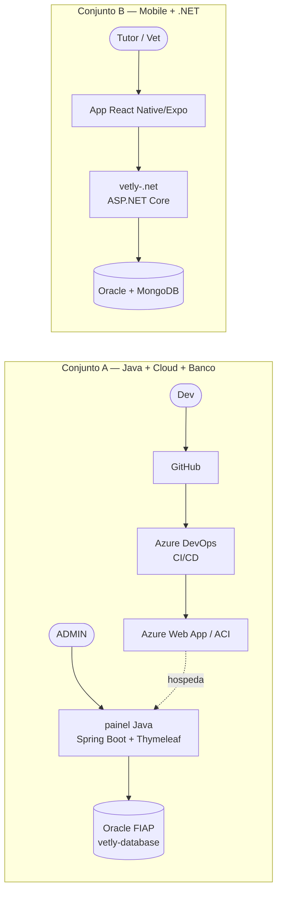
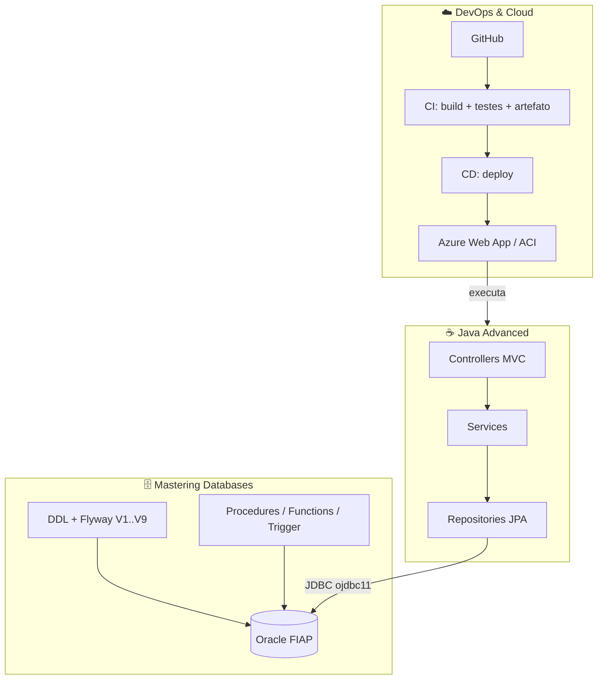
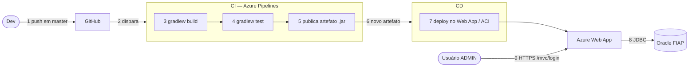

# Vetly — Entrega Final (Sprint 4) · Java Advanced

Documento da entrega final da disciplina **Java Advanced**, organizado pelos cinco
critérios do enunciado oficial do Challenge 2026 (2º semestre). Mostra o painel
o painel Java como parte de um conjunto integrado com **Cloud** e **Banco de Dados**.

> **Convenção de status.** ✅ existe no repositório/verificado · 🟡 existe parcialmente ·
> ⬜ pendente — precisa ser feito/preenchido pelo grupo antes de 04/11/2026.
> Nada abaixo marcado como ✅ foi presumido: cada item aponta o arquivo que o comprova.

## Índice

1. [Visão geral: dois conjuntos integrados](#1-visão-geral-dois-conjuntos-integrados)
2. [Conjunto 1 — Java + Cloud + Banco de Dados](#2-conjunto-1--java--cloud--banco-de-dados)
3. [Conjunto 2 — Mobile + .NET](#3-conjunto-2--mobile--net)
4. [Mapa dos requisitos do enunciado](#4-mapa-dos-requisitos-do-enunciado)
5. [Narrativa da solução](#5-narrativa-da-solução)
6. [Roteiro do vídeo (máx. 15 min)](#6-roteiro-do-vídeo-máx-15-min)
7. [Checklist final de entrega](#7-checklist-final-de-entrega)

---

## 1. Visão geral: dois conjuntos integrados

O Vetly é um marketplace que conecta tutores a veterinários independentes, com um
prontuário portátil que pertence ao **animal**, não à clínica. No Challenge, as
disciplinas do semestre se agrupam em **dois conjuntos**, cada um com sua própria
cadeia de ponta a ponta:

| Conjunto | Disciplinas | Repositório(s) | Papel |
|---|---|---|---|
| **A — Back-office** | Java Advanced · DevOps & Cloud · Mastering Databases | `mvc-vetly-java` (Java) + [`vetly-database`](https://github.com/challenge-vetly/vetly-database) — **dois repositórios** | Painel administrativo (ADMIN) sobre Oracle, publicado na Azure por pipeline CI/CD |
| **B — Produto** | Mobile Application Development · Advanced Business Development with .NET | `vetly-.net` + app mobile (React Native/Expo) | App do tutor/veterinário consumindo a API REST |

**Os dois conjuntos são independentes de propósito.** O painel Java tem identidade,
dados e deploy próprios, **sem integração** com o `.NET` (decisão registrada no README
principal). O que os une é o domínio e as regras de negócio (RN-001 a RN-107, em
`vetly-qa/vetly-tech.md`) e a mesma instituição de banco (Oracle FIAP).

> O restante deste documento detalha o **Conjunto A**, que é o escopo desta disciplina.
> O Conjunto B é descrito na [seção 3](#3-conjunto-2--mobile--net) só para situar a entrega.

---

## 2. Conjunto 1 — Java + Cloud + Banco de Dados

### 2.1 Como as três disciplinas se encaixam

| Disciplina | O que entrega para o projeto | Evidência no repositório |
|---|---|---|
| **Java Advanced** | Aplicação Spring Boot 4 / Java 21: MVC server-side, JPA, Spring Security (form login + BCrypt), Bean Validation, máquina de estados de consulta, versionamento de prontuário (RN-088/089) | `src/main/java/com/vetly/vetly_java/`, [README.md](../README.md) |
| **Mastering Databases** | Modelo relacional Oracle (modelagem lógica/física), DDL, migrations versionadas, procedures/funções/trigger com tratamento de exceção | `vetly-database/` (`DDL.txt`, `modelagem-db/`, `scripts/`, `mongo/`) e `src/main/resources/db/migration/V1..V10` |
| **DevOps & Cloud** | Container/artefato da app, pipeline CI/CD no Azure DevOps, deploy em recurso Azure, segredos protegidos | ⬜ ver [2.3](#23-cloud-deploy-e-cicd) |

**Regra de ouro da integração:** *uma única base Oracle* serve ao Java (via JPA), às
procedures (via SQL) e é o banco consultado na demonstração do CRUD no vídeo. O Flyway
é o dono do schema (`ddl-auto=validate`); o `vetly-database/DDL.txt` consolida o schema e deve receber o DDL de cada migration nova.

### 2.2 Banco de Dados (Oracle)

**Fontes:**

| Artefato | Local | Status |
|---|---|---|
| DDL completo (19 tabelas) | `vetly-database/DDL.txt` | ✅ |
| Migrations Flyway V1..V10 | `src/main/resources/db/migration/` (fonte única; a V10 é gerada de `vetly-database/scripts/` e copiada para cá) | ✅ |
| Modelagem lógica e relacional (PNG + Data Modeler) | `vetly-database/modelagem-db/` | ✅ |
| Procedures de carga | `vetly-database/scripts/06_pkg_vetly_carga.sql` (`PKG_VETLY_CARGA`) | ✅ |
| Relatórios SQL com saída | `vetly-database/relatorios/relatorio-1..4` | ✅ |

**Sprint 4 de Banco de Dados — entregue no repositório `vetly-database`:**

| Exigência do enunciado | Situação | Onde |
|---|---|---|
| Objetos **empacotados** | ✅ `PKG_VETLY_LOG`, `_VALIDACAO`, `_JSON`, `_RELATORIO`, `_CARGA` (16 procedures) + `TRG_AUD_CONSULTA`, com tratamento de exceção | `vetly-database/scripts/01..06` |
| Procedures **chamadas pela aplicação** | ✅ Tela `/mvc/relatorios/consultas` chama `PKG_VETLY_RELATORIO.prc_consultas_vet_status` via `SimpleJdbcCall` | `RelatorioConsultasService`, `RelatorioMvcController`, `templates/relatorios/consultas.html` |
| Export **JSON** do relacional | ✅ `PKG_VETLY_JSON.fn_dataset_animais_json` + `SPOOL` no cliente | `vetly-database/mongo/01_exportar_dataset.sql`, `dataset/animais.ndjson` |
| Importação no **MongoDB** | ✅ Coleção `animais` (tutor e consultas embutidos), validador de schema, índices, consultas de demonstração | `vetly-database/mongo/02_importar_mongo.js`, `03_consultas_demo.js` |
| Modelo lógico/físico reentregue com correções do professor | 🟡 Existe em `modelagem-db/`; falta aplicar o feedback da Sprint 3 (não está no repositório) | — |
| Vídeo da execução | ⬜ gravar | roteiro na seção 6 |

**Integração Java ↔ Banco independente de ambiente.** Os pacotes chegam pela migration
`V10__pacotes_plsql_auditoria.sql`, idêntica nos dois repositórios: qualquer deploy (Web App,
ACI, local) recebe os objetos quando o Flyway roda. Os objetos não usam `DBMS_OUTPUT`,
`UTL_FILE`/`DIRECTORY` nem dependem de NLS (máscaras fixas); a conexão é só por variável de
ambiente; a chamada não consulta o dicionário de dados. Detalhes e verificação em
[`vetly-database/README.md`](https://github.com/challenge-vetly/vetly-database/blob/main/README.md).

`TRG_AUD_CONSULTA` audita também as gravações feitas pelo Java (JPA) em `TB_CONSULTA`, em
`TB_AUDITORIA`.

> **Verificado em Oracle Free 23ai e MongoDB 7 (containers):** 21 verificações SQL passam;
> o app Java subiu contra um schema **vazio** com Flyway V1→V10 e a tela respondeu com
> total R$ 1.200,00, igual ao total agregado no Mongo. A V10 **ainda não foi aplicada no Oracle
> da FIAP** — roda sozinha no primeiro start do app contra ele.

### 2.3 Cloud: deploy e CI/CD

Estado atual do repositório:

| Item | Status | Observação |
|---|---|---|
| Aplicação executa em `localhost:8080` | ✅ | `./gradlew bootRun` |
| Dockerfile | ⬜ | Não existe neste repositório |
| `azure-pipelines.yml` | ⬜ | Não existe |
| Pipelines GitHub em `workflows/` | 🟡 | Só promovem PRs (feature→develop→homolog→main). **Estão fora de `.github/workflows/`, logo não executam hoje** |
| Projeto no Azure DevOps (`Sprint 4 – Azure DevOps`) | ⬜ | Professor com acesso **Basic** |
| URL pública da aplicação | ⬜ | **"Rodando em localhost" zera a nota** (enunciado de Cloud) |

**Alvo de deploy proposto** (decisão do grupo — confirmar): **Azure Web App** (Java 21,
publicando o `.jar` gerado pelo CI) conectado ao **Oracle da FIAP**, que o enunciado
aceita como banco em nuvem. A alternativa é ACR + ACI com a imagem Docker; em ambos os
casos o banco continua sendo o Oracle FIAP. O `vetly-.net` já alcança `oracle.fiap.com.br`
a partir de uma VM Azure (`vetly-.net/deploy/azure-vm-deploy.ps1`), o que indica que a
rota de rede existe — validar a partir do Web App escolhido.

**Pipeline exigida** (regras I–VII do enunciado de Cloud):

Pontos que a pipeline precisa cumprir, e onde este projeto já ajuda:

| Regra | Como atender |
|---|---|
| CI dispara a cada alteração na branch `master` | O enunciado fala em `master`; o repositório usa `main`. Configurar o gatilho da pipeline para a branch que de fato será o tronco, ou criar `master` — **decidir antes de gravar o vídeo** |
| Testes no CI | `./gradlew test` ✅ roda, mas hoje só existe o smoke test de contexto — **ausência de testes no CI custa −20 pts**; vale cobrir `mvc/service/*AdminService` |
| Artefato publicado no Azure DevOps | `PublishBuildArtifacts` do `build/libs/*.jar` |
| Variáveis sensíveis protegidas | `application.properties` hoje versiona usuário/senha do Oracle (−15 pts). Mover para variáveis secretas da pipeline e usar `SPRING_DATASOURCE_URL/USERNAME/PASSWORD` e `VETLY_ADMIN_BOOTSTRAP_*` (o Spring já lê por ambiente) |
| Alterar **código** no vídeo, não README | Preparar uma mudança visível (ex.: o título "Painel" em `templates/dashboard.html`) |
| CRUD com `SELECT` no banco | Roteiro na [seção 6](#6-roteiro-do-vídeo-máx-15-min) |

### 2.4 Fluxos para demonstrar (Java)

Todos sob `/mvc/**`, só `ADMIN`. CRUD completo e relacionado, que serve tanto à
disciplina de Java quanto à de Cloud (que exige CRUD sobre ao menos duas tabelas
relacionadas, com `SELECT` comprovando cada operação):

| Fluxo | Tabelas envolvidas | Operações |
|---|---|---|
| Tutor → Animal | `TB_USUARIO`, `TB_PESSOA`, `TB_TUTOR`, `TB_ANIMAL` | Criar, consultar, editar, excluir |
| Veterinário → Especialidade/Espécie | `TB_VETERINARIO` e as tabelas associativas de especialidade/espécie | Criar com vínculos; exclusão remove vínculos antes |
| Consulta | `TB_CONSULTA` | Agendar, reagendar, mudar status (máquina de estados) |
| Prontuário | `TB_PRONTUARIO` | Criar e **corrigir** com versão nova + justificativa (RN-088/089) |
| Exames | `TB_SOLICITACAO_EXAME(_ITEM)` | Solicitar, registrar resultado, liberar ao responsável (RN-104) |

---

## 3. Conjunto 2 — Mobile + .NET

Situa a entrega; não é avaliado na disciplina de Java.

- **`vetly-.net`** — backend completo (ASP.NET Core, EF Core 10, Oracle, MongoDB,
  Serilog/OpenTelemetry, health checks, 1.336 testes). Deploy próprio em VM Azure com
  Docker Compose + Caddy (`vetly-.net/deploy/`).
- **App mobile** — React Native/Expo (enunciado de Mobile), consumindo a API `.NET`.
  O repositório do app **não existe neste checkout**; a documentação de projeto não
  confirma a estrutura da versão atual. Completar com o link do repositório do app.

A separação é intencional: Mobile e .NET entregam o **produto** (tutor/veterinário);
Java, Cloud e Banco entregam o **back-office** administrativo sobre o mesmo domínio.

---

## 4. Mapa dos requisitos do enunciado

| # | Critério (pts) | Como atendemos | Evidência | Status |
|---|---|---|---|---|
| 1 | **Demonstração técnica** (40) — online, fluxos, conceitos, UI/UX | Painel Thymeleaf com login, dashboard e CRUDs; Security, JPA, Validation, Flyway | [README](../README.md) · telas em `src/main/resources/templates/` | 🟡 falta URL pública (⬜ deploy) |
| 2 | **Narrativa** (20) — proposta, decisões, originalidade | [Seção 5](#5-narrativa-da-solução) | `README.md` "Mudança de arquitetura", `Decisão de implementação registrada` | ✅ texto pronto; ensaiar a fala |
| 3 | **Integração multidisciplinar** (20) — disciplinas + evidências | [Seção 2](#2-conjunto-1--java--cloud--banco-de-dados) | DDL, modelagem, pacotes PL/SQL, Mongo, pipeline | 🟡 banco ✅; falta pipeline (2.3) |
| 4 | **Apresentação oral** (10) — todos participam | [Seção 6](#6-roteiro-do-vídeo-máx-15-min) com divisão por integrante | `integrantes.txt` | ⬜ gravar |
| 5 | **Organização e documentação** (10) | README + este documento; repositórios canônicos separados dos legados | Esta pasta `docs/` | ✅ |

**Artefatos de entrega do Java:** repositório GitHub com README completo · link de
acesso à aplicação · vídeo de **no máximo 15 minutos**.

---

## 5. Narrativa da solução

**Problema.** Um animal passa por vários veterinários e clínicas, e cada um mantém um
prontuário próprio e isolado. O histórico não acompanha o animal, o tutor não enxerga
nada e exames se perdem.

**Proposta.** O Vetly inverte o dono do dado: o **prontuário pertence ao animal** e é
portátil entre profissionais, com consentimento (LGPD) do tutor. Este painel é o
back-office que a equipe da plataforma usa para operar essa base: cadastrar tutores,
veterinários, animais, agendar consultas, registrar exames e manter o prontuário.

**Decisões de design e justificativas:**

| Decisão | Justificativa |
|---|---|
| Resolver a duplicidade REST + MVC ficando **só com MVC** | Duas arquiteturas e dois modelos de segurança (JWT e sessão) no mesmo código aumentavam a superfície de erro sem ganho; o único ator é o ADMIN, para quem sessão basta |
| Server-side rendering (Thymeleaf) | Back-office de formulários e listagens; sem necessidade de SPA, menos peças para fazer deploy |
| **Flyway** como dono do schema, Hibernate em `validate` | O banco da FIAP é compartilhado e já existia; migrations versionadas evitam divergência silenciosa entre entidade e tabela |
| Prontuário **versionado**, nunca sobrescrito (RN-088/089) | Auditabilidade clínica: toda correção gera nova versão com CRMV e justificativa |
| Oracle da FIAP como banco único | Exigência da disciplina de Banco e aceito pela de Cloud; mesma base serve JPA e procedures |
| Dois conjuntos independentes (Java/Cloud/DB × Mobile/.NET) | Evita acoplar entregas de disciplinas com cronogramas e critérios distintos |

**Originalidade:** prontuário centrado no animal com versionamento e liberação
controlada de exames ao responsável (RN-104); regras de negócio rastreadas por RN em
cada migration e na documentação.

---

## 6. Roteiro do vídeo (máx. 15 min)

Todos os integrantes devem aparecer e falar. Divisão sugerida (ajustar):

| Min | Bloco | Quem | Conteúdo |
|---|---|---|---|
| 0–2 | Abertura e problema | Integrante 1 | Vetly, o problema, os dois conjuntos de disciplinas |
| 2–6 | Demo Java online (URL pública) | Integrante 2 | Login, dashboard, Tutor→Animal, Consulta, Prontuário (criar + corrigir), Exame |
| 6–9 | Banco de dados | Integrante 3 | Modelagem, `DDL.txt`/Flyway, procedure chamada pela app, `SELECT` após cada operação do CRUD |
| 9–13 | Cloud | Integrante 4 | Azure DevOps, pipeline (jobs/tasks), alterar um título no código → `push` → pipeline dispara sozinha → artefato + testes → recursos no portal Azure → app atualizada |
| 13–15 | Fechamento | Todos | Decisões de design, integração entre disciplinas, Mobile/.NET como conjunto B |

Para o CRUD, mostrar a tela ao lado de um cliente SQL com o `SELECT` correspondente
(ex.: `SELECT * FROM TB_ANIMAL WHERE NM_ANIMAL = '…'`) a cada INSERT, UPDATE e DELETE.

---

## 7. Checklist final de entrega

- [ ] Decidir `master` × `main` para o gatilho do CI
- [ ] `Dockerfile` (se ACR/ACI) ou perfil de empacotamento do `.jar` (se Web App)
- [ ] `azure-pipelines.yml` com CI (build + testes + artefato) e CD (deploy)
- [ ] Segredos do Oracle e do ADMIN bootstrap fora do `application.properties` (variáveis protegidas)
- [ ] Projeto `Sprint 4 – Azure DevOps` privado, professor com acesso **Basic**
- [ ] Deploy no Azure Web App ou ACI, **URL pública** testada fora da rede local
- [ ] Testes automatizados reais (hoje só o smoke test de contexto)
- [x] Procedures em **packages** e ao menos uma chamada pelo Java (V10 + tela de relatório)
- [x] JSON exportado + import MongoDB (`vetly-database/mongo/`)
- [ ] Aplicar a V10 no Oracle da FIAP (primeiro start do app) e conferir `TB_AUDITORIA` e a tela de relatório online
- [ ] Reentregar a modelagem lógica/física com o feedback do professor
- [ ] Diagrama de arquitetura + fluxo CI/CD desenhado em ferramenta própria (o enunciado de Cloud rejeita desenho parecido com fluxograma/UML; os diagramas Mermaid acima servem de rascunho)
- [ ] Vídeo ≤ 15 min, 720p+, todos falando, áudio claro, publicado no YouTube (não listado)
- [ ] PDF só com nomes, RMs, turmas e links (GitHub, YouTube, Azure DevOps)
- [ ] Repositório público com README completo na branch `develop`
